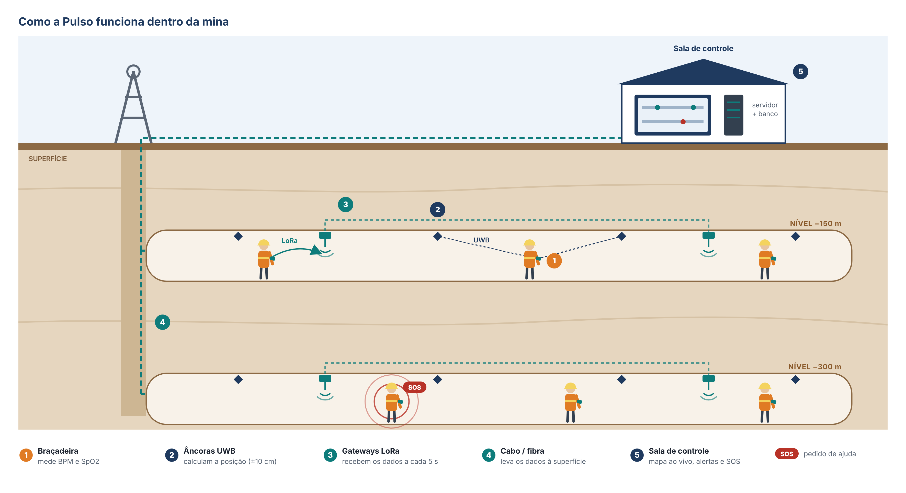
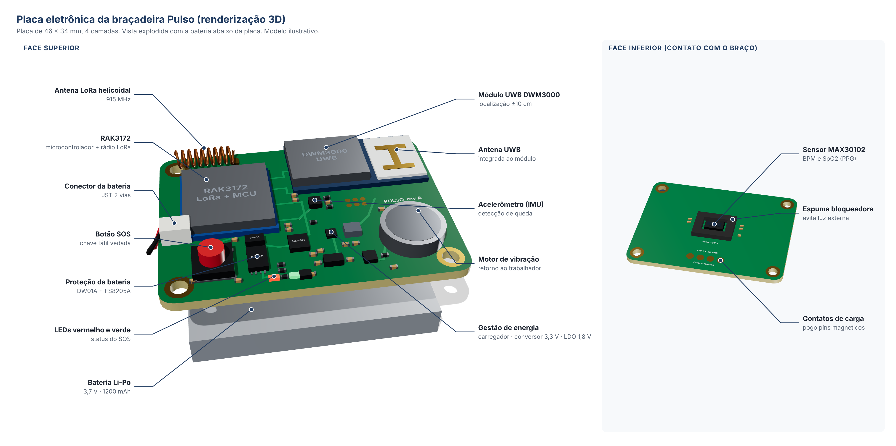

# Pulso

> **Enquanto há pulso, há controle.**

Braçadeira conectada (EPI) para trabalhadores de mineração subterrânea. Monitora **frequência cardíaca (BPM)** e **saturação de oxigênio (SpO2)**, localiza o trabalhador com **UWB (±10 cm)**, transmite os dados pela **rede LoRa subterrânea** a cada 5 segundos e tem **botão SOS** para emergências. Tudo aparece em tempo real num dashboard na sala de controle.

Trabalho de Conclusão de Curso, Engenharia Mecatrônica, FIAP (2026).

## Como funciona

1. **Braçadeira:** mede BPM e SpO2 com sensor óptico (PPG) e tem botão SOS, LEDs e vibração.
2. **Âncoras UWB:** ficam no teto das galerias e calculam a posição do trabalhador.
3. **Gateways LoRa:** recebem os pacotes a cada 5 s e enviam à superfície por cabo ou fibra.
4. **Servidor:** valida e filtra os dados, grava no banco e dispara alertas em menos de 3 s.
5. **Dashboard:** mostra o mapa ao vivo, os sinais vitais, os alertas e os relatórios NR-22.

## Documentação

| Documento | Conteúdo |
|---|---|
| [Visão geral](docs/textos/visao-geral.md) | Problema, solução, mercado, concorrentes, modelo de negócio e roadmap |
| [Como funciona o sistema](docs/textos/funcionamento-do-sistema.md) | Braçadeira, UWB, LoRa, servidor e dashboard |
| [Banco de dados](docs/textos/banco-de-dados.md) | Banco, armazenamento e tratamento dos dados |
| [Sistema de emergência](docs/textos/sistema-de-emergencia.md) | Botão SOS, alertas automáticos e escalonamento |
| [Hardware](hardware/README.md) | Explicação, diagrama elétrico, placa 3D e lista de componentes |
| [Figuras](figuras/README.md) | Todas as figuras com as legendas sugeridas para o TCC |
| [Pendências do TCC](docs/textos/pendencias-tcc.md) | Inconsistências e partes a preencher |

## Estrutura do repositório

| Pasta | Conteúdo |
|---|---|
| [`docs/tcc`](docs/tcc) | Documento do TCC |
| [`docs/textos`](docs/textos) | Textos técnicos: banco de dados, emergência, funcionamento e hardware |
| [`figuras`](figuras) | Figuras prontas para o TCC (PNG) e suas fontes editáveis (`figuras/fontes`) |
| [`hardware`](hardware) | Diagrama elétrico, placa 3D e lista de componentes |
| [`firmware`](firmware) | Código da braçadeira *(a desenvolver)* |
| [`dashboard`](dashboard) | Interface da sala de controle *(a desenvolver)* |
| [`digital-twin`](digital-twin) | Simulação do sistema *(a adicionar)* |

## Hardware

O microcontrolador **RAK3172** (STM32WLE5 + LoRa) se comunica com o módulo **UWB DWM3000**, com o sensor **MAX30102** (BPM e SpO2) e com o acelerômetro **LIS2DH12**. A alimentação vem de uma bateria **Li-Po de 1200 mAh** com proteção, carregador com power-path e recarga por contatos magnéticos.

Veja a [explicação completa, o diagrama elétrico e a lista de componentes](hardware/README.md).

## Equipe

| Integrante | Função |
|---|---|
| Matheus Vilela de Andrade | Pesquisa / Produto |
| Murilo Mansour Xerfan Silva | Desenvolvimento de Hardware |
| Vitor Comunale Silva | Fundador / Vendas |
| Danilo Costa | Desenvolvimento de Interface |
| Fabrizio Darin Muracca | Desenvolvimento de Rede |

## Como editar as figuras

- **Figuras do sistema** (`figuras/fontes/*.html`): abra no navegador, edite o HTML e tire um print ou exporte.
- **Diagrama elétrico:** `python3 hardware/diagrama-eletrico/schem.py saida.html` gera o HTML do diagrama.
- **Placa 3D:** abra `hardware/placa-3d/placa_3d.html` no navegador (precisa de internet para carregar o three.js).
