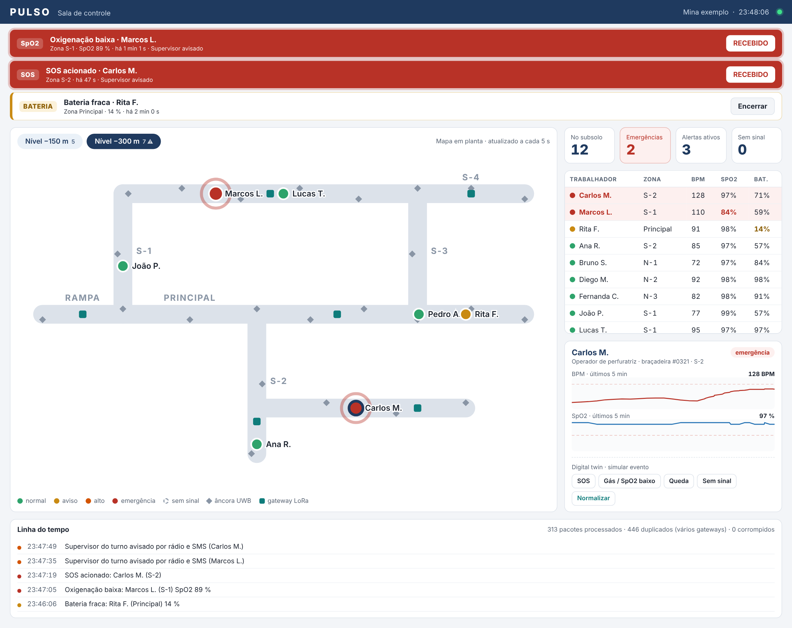

# Dashboard da sala de controle

Interface web em HTML, CSS e JavaScript puros, sem build. É servida pelo próprio servidor da Pulso e recebe o estado a cada 1 s por Server-Sent Events (`/api/stream`).

## Funções

- **Faixa de alertas** ordenada por gravidade: SOS, oxigenação baixa e queda (vermelho), sinal e BPM (laranja), bateria e sensor (amarelo). Mostra a zona, o tempo decorrido e a etapa de escalonamento.
- **Botão RECEBIDO:** registra quem atendeu e envia o downlink para a braçadeira, que acende o LED verde ("ajuda a caminho"). Depois, **Encerrar** fecha o caso.
- **Mapa em planta** de cada nível, com galerias, zonas, âncoras UWB, gateways e os trabalhadores coloridos pelo estado. Quem está em emergência pisca.
- **Indicadores:** pessoas no subsolo, emergências, alertas ativos e braçadeiras sem sinal.
- **Lista de trabalhadores** com zona, BPM, SpO2 e bateria, com valores fora do normal destacados.
- **Detalhe do trabalhador** com gráficos de BPM e SpO2 dos últimos 5 minutos.
- **Linha do tempo** de todos os eventos (alertas, escalonamentos e atendimentos) e estatísticas da rede.
- **Alarme sonoro** quando surge uma nova emergência.
- **Botões do digital twin** para simular eventos durante a apresentação.

## Arquivos

| Arquivo | Conteúdo |
|---|---|
| `index.html` | Estrutura da página |
| `style.css` | Visual, nas cores da Pulso (também funciona no celular) |
| `app.js` | Conexão com a API, desenho do mapa, alertas, gráficos |

Para rodar, use `python3 run_demo.py` na raiz e abra http://localhost:8080.
