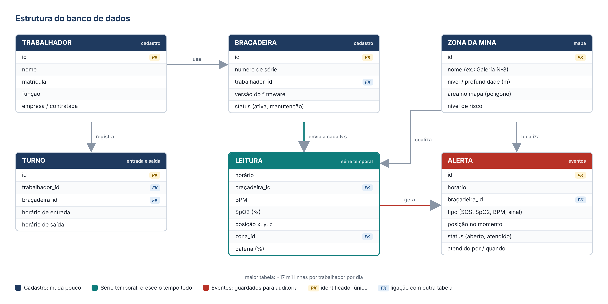
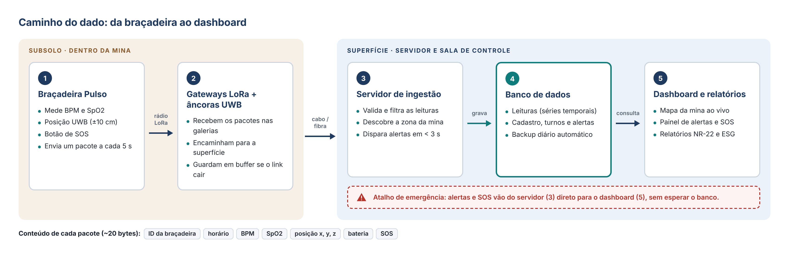
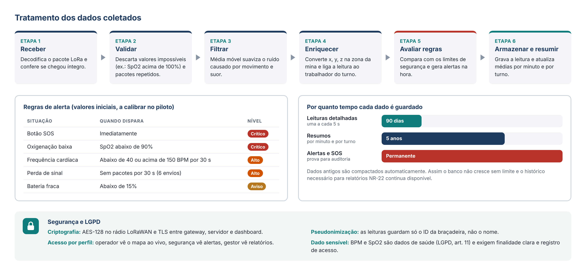

# Banco de dados, armazenamento e tratamento dos dados

## Banco de dados

Os dados ficam em um banco **PostgreSQL** com a extensão **TimescaleDB**, própria para séries temporais. O banco tem dois tipos de tabela:

- **Cadastro**, que muda pouco: trabalhadores, braçadeiras, zonas da mina e turnos.
- **Dados em tempo real**, que crescem o tempo todo: as leituras (BPM, SpO2 e posição, a cada 5 s) e os alertas.

As leituras guardam só o ID da braçadeira. A tabela de turnos faz a ligação com o trabalhador, para separar os dados de saúde dos dados pessoais.

## Armazenamento

O dado percorre cinco etapas: braçadeira → gateway LoRa → servidor → banco → dashboard. Se a ligação com a superfície cair, os gateways guardam os pacotes em um buffer e os reenviam depois. Alertas e SOS seguem um caminho direto do servidor para o dashboard, para chegar em menos de 3 s.

O tempo de guarda de cada dado é:
- leituras detalhadas: 90 dias;
- resumos por minuto e por turno: 5 anos;
- alertas: permanente, como prova para auditoria.

Há backup diário.

## Tratamento

Cada leitura passa por seis etapas: **receber**, **validar**, **filtrar** (média móvel), **enriquecer** (identificar a zona da mina e o trabalhador), **avaliar regras** (gerar alertas) e **armazenar e resumir**.

A comunicação é criptografada com AES-128 no rádio LoRaWAN e TLS na rede. O acesso é separado por perfil. BPM e SpO2 são dados de saúde, classificados como sensíveis pela LGPD (art. 11).

