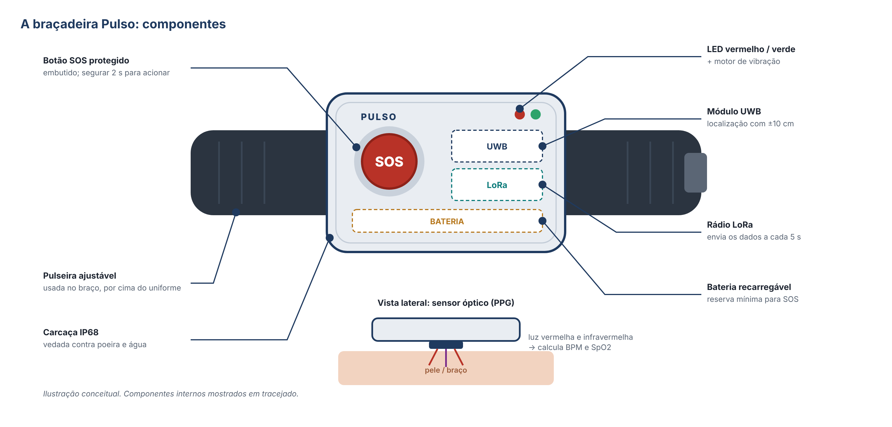

# Como funciona o sistema

A Pulso tem quatro partes que trabalham juntas: a **braçadeira**, a **rede dentro da mina**, o **servidor** e o **dashboard**.

1. **Braçadeira:** o trabalhador usa a braçadeira no braço durante todo o turno. Um sensor óptico em contato com a pele mede o **BPM** e o **SpO2** com luz vermelha e infravermelha. Ela também tem o **botão SOS**, LEDs e um motor de vibração.
2. **Localização (UWB):** âncoras UWB presas no teto das galerias medem a distância até a braçadeira, e o sistema calcula a posição com cerca de **±10 cm**, sem GPS.
3. **Comunicação (LoRa):** a cada **5 segundos**, a braçadeira envia um pacote pequeno (cerca de 20 bytes). Os gateways LoRa das galerias recebem e enviam à superfície por cabo ou fibra.
4. **Servidor:** valida os dados, identifica a zona da mina, grava no banco de dados e compara com os limites de segurança.
5. **Dashboard:** mostra o mapa da mina com cada trabalhador como um ponto colorido (verde é normal, amarelo é aviso, vermelho é emergência) e os sinais vitais. Em caso de SOS ou de um valor perigoso, o alarme aparece em menos de 3 s com a posição exata.

Resumindo: **a braçadeira mede, a rede transmite, o servidor analisa e o dashboard mostra**.

## A braçadeira

## O dashboard

## Textos relacionados

- [Banco de dados, armazenamento e tratamento](banco-de-dados.md)
- [Sistema de emergência e botão SOS](sistema-de-emergencia.md)
- [Hardware e lista de componentes](../../hardware/README.md)
