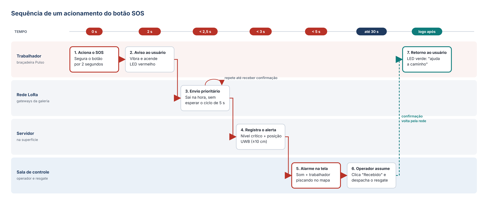
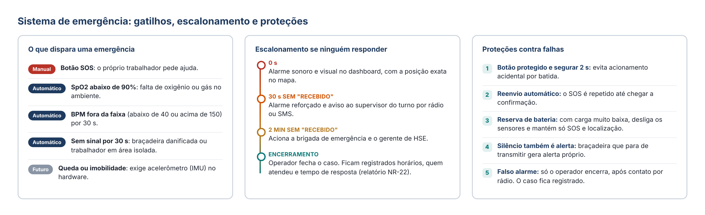

# Sistema de emergência e botão SOS

## Botão SOS

1. O trabalhador segura o botão por **2 s**, o que evita acionamentos acidentais.
2. A braçadeira vibra e acende o LED vermelho.
3. O pacote de SOS sai na hora, sem esperar o ciclo de 5 s, e é reenviado até ser confirmado.
4. O servidor registra um alerta crítico com a posição UWB.
5. A sala de controle recebe um alarme sonoro, e o trabalhador aparece piscando no mapa (em menos de 3 s).
6. O operador clica em "Recebido" e despacha o resgate.
7. A braçadeira acende o LED verde: "ajuda a caminho".

## Sistema de emergência

Além do SOS, há **alertas automáticos** para quando o trabalhador não consegue apertar o botão:
- SpO2 abaixo de 90%;
- BPM fora da faixa (abaixo de 40 ou acima de 150) por 30 s;
- braçadeira sem sinal por 30 s;
- queda, detectada pelo acelerômetro.

**Escalonamento:** se ninguém confirmar o alerta em 30 s, o sistema avisa o supervisor do turno. Se passar de 2 minutos, aciona a brigada de emergência e o gerente de HSE. Só o operador encerra um caso, e tudo fica registrado para os relatórios NR-22.

