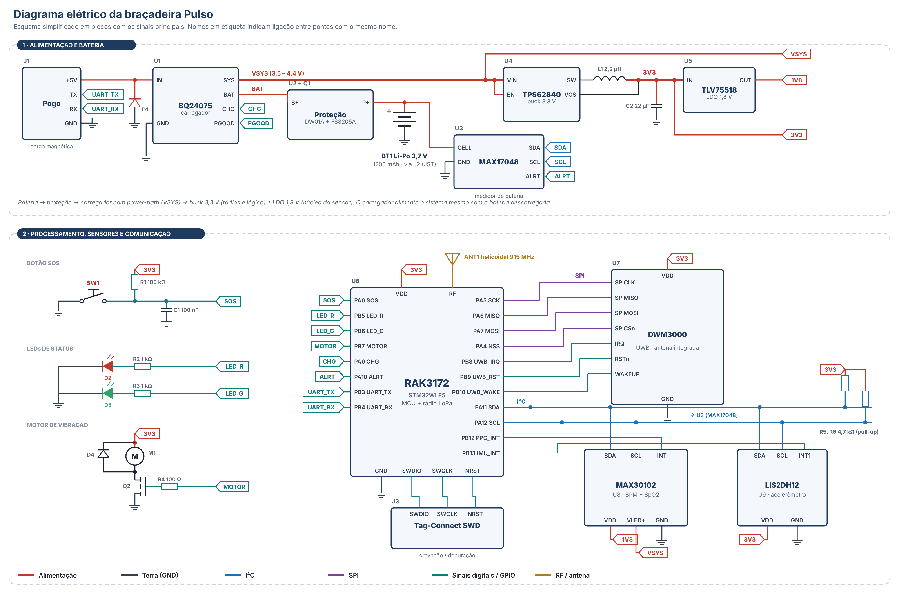

# Hardware da braçadeira

## Explicação

A braçadeira é alimentada por uma **bateria Li-Po de 3,7 V e 1200 mAh**, protegida contra sobrecarga, descarga excessiva e curto-circuito pelo conjunto DW01A + FS8205A. A recarga é feita por **contatos magnéticos (pogo pins)**, que dispensam uma porta USB aberta e mantêm a vedação IP68. O carregador BQ24075 tem *power-path*: alimenta o circuito e carrega a bateria ao mesmo tempo. A tensão do sistema é convertida em **3,3 V** por um conversor buck de alta eficiência, que alimenta os rádios e a lógica, e em **1,8 V** por um LDO, que alimenta o núcleo do sensor óptico. Um medidor de bateria (MAX17048) informa a carga restante, que aparece no dashboard.

O cérebro do sistema é o **RAK3172**, que reúne o microcontrolador STM32WLE5 e o rádio LoRa (915 MHz, padrão AU915). Por SPI, ele se comunica com o **módulo UWB DWM3000**, que calcula a posição com cerca de ±10 cm. Por I²C, conversa com o **sensor MAX30102**, que fica na face de baixo da placa, encostado no braço, e mede **BPM e SpO2**, e com o **acelerômetro LIS2DH12**, usado na detecção de queda. O **botão SOS** tem filtro RC e acorda o microcontrolador na hora. O **LED vermelho e verde** e o **motor de vibração** (acionado por um MOSFET) dão o retorno ao trabalhador. O consumo médio estimado é de poucos miliampères, o que deve garantir mais de um turno de 12 h por carga. Esse valor ainda precisa ser confirmado em bancada.

## Lista de componentes

| Nome | Descrição | Quantidade |
|---|---|---|
| Bateria Li-Po 3,7 V 1200 mAh | Fonte de energia recarregável | 1 |
| Conector JST-SH 2 vias (J2) | Liga a bateria à placa | 1 |
| DW01A (U2) | CI de proteção da bateria (sobrecarga, descarga excessiva e curto-circuito) | 1 |
| FS8205A (Q1) | MOSFET duplo que corta a bateria em caso de falha | 1 |
| Conector pogo pin magnético 4 vias (J1) | Recarga e configuração sem abrir a carcaça | 1 |
| Diodo TVS SMF5.0A (D1) | Proteção contra surtos e descarga eletrostática na entrada de carga | 1 |
| BQ24075 (U1) | Carregador de Li-Po com power-path | 1 |
| MAX17048 (U3) | Medidor do nível de bateria (%) | 1 |
| TPS62840 (U4) | Conversor buck de 3,3 V com consumo ultrabaixo | 1 |
| Indutor 2,2 µH (L1) | Indutor do conversor buck | 1 |
| TLV75518 (U5) | Regulador LDO de 1,8 V para o sensor óptico | 1 |
| RAK3172 (U6) | Microcontrolador STM32WLE5 + rádio LoRa | 1 |
| Antena helicoidal 915 MHz (ANT1) | Antena do rádio LoRa | 1 |
| Qorvo DWM3000 (U7) | Módulo UWB com antena integrada, para localização de ±10 cm | 1 |
| MAX30102 (U8) | Sensor óptico (PPG) de BPM e SpO2 | 1 |
| LIS2DH12 (U9) | Acelerômetro para detecção de queda e imobilidade | 1 |
| Chave tátil vedada IP67 (SW1) | Botão SOS | 1 |
| LED 0603 vermelho e verde (D2, D3) | Status do SOS ("enviado" e "ajuda a caminho") | 2 |
| Motor de vibração tipo moeda 10 mm (M1) | Alerta tátil ao trabalhador | 1 |
| MOSFET N AO3400 (Q2) | Aciona o motor de vibração | 1 |
| Diodo BAT54 (D4) | Proteção do MOSFET contra o retorno do motor | 1 |
| Resistores 0402 | Pull-ups do I²C, filtro do botão, limitação dos LEDs e ajustes do carregador | 10 |
| Capacitores cerâmicos 0402/0603 | Desacoplamento e filtragem (100 nF a 22 µF) | 18 |
| Conector Tag-Connect SWD (J3) | Pads para gravar e depurar o firmware | 1 |
| Espuma bloqueadora de luz | Isola o sensor óptico da luz externa | 1 |
| Placa de circuito impresso 4 camadas | PCB de 46 × 34 mm | 1 |
| Carcaça IP68 + pulseira | Invólucro vedado com janela óptica para o sensor | 1 |

## Placa 3D (modelo ilustrativo)

